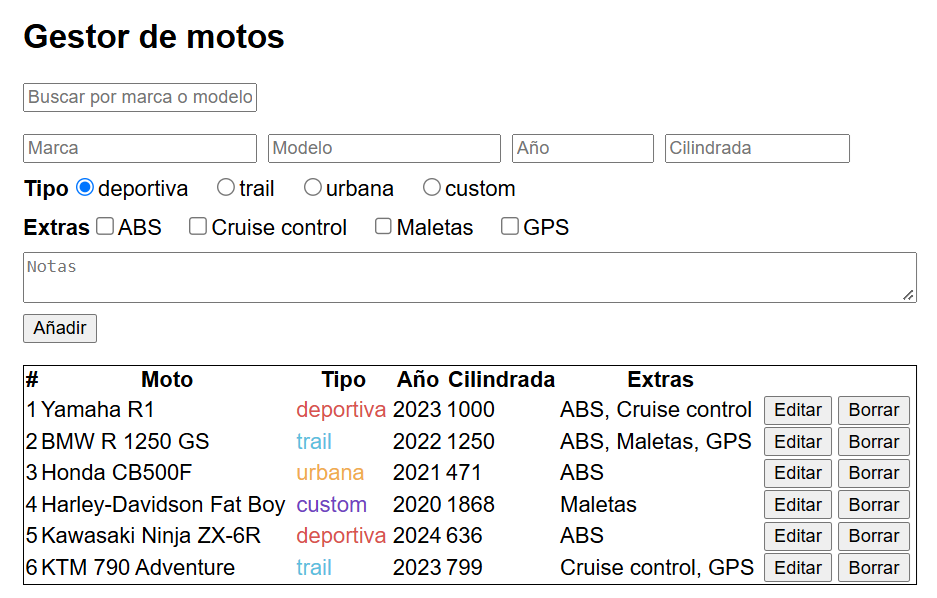

# Ejercicios de React — Sesiones 4, 5 y 6

> ⚠️ **Importante.** Cada bloque tiene **3–4 ejercicios**: supuestos **prácticos** (no preguntas teóricas) con **datos reales** (los `.json` de cada bloque, servidos tal cual o por `json-server`). Cada ejercicio usa **solo lo visto hasta ese bloque**: nada de hooks, eventos ni patrones que lleguen más adelante. Si un ejercicio parece pedir algo que no se ha visto, relee el apunte de referencia del bloque.

> 🧪 **Cómo se trabaja.** Los ejercicios son componentes React: se escriben en `.tsx` dentro de una app Vite de pruebas. Crea una con `npm create vite@latest -- --template react-ts` (o reutiliza una copia de [`repos/02-react-componentes`](../repos/02-react-componentes/)), copia los datos desde `ejerciciosRT/datos/` al proyecto y monta cada ejercicio desde `App.tsx`. Los bloques que hacen `fetch` (12 y 15) además necesitan la API local de [FAKEAPI](#montar-la-api-local-con-fakeapi). 

> ✅ **Soluciones.** Cada bloque tiene su solución resuelta en su subcarpeta: `tipos.ts` (las entidades), `ej1.tsx`–`ej3.tsx` (un supuesto por ejercicio) y `App.tsx`, que monta los tres para probarlos. Para ejecutar una solución: crea una app Vite, **sustituye el contenido de `src/` por el de la subcarpeta del bloque** (su `App.tsx` reemplaza al de la plantilla; un bloque por app) y `npm run dev`.

> 📦 **Datos reales.** Los datos comunes están centralizados en **4 ficheros con wrapper**, reutilizables por varios bloques: [`ejerciciosRT/datos/peliculas.json`](datos/peliculas.json) (`{"peliculas": [...]}` — usado por 11 y 13), [`ejerciciosRT/datos/alumnos.json`](datos/alumnos.json) (`{"alumnos": [...]}` — usado por 12), [`ejerciciosRT/datos/libros.json`](datos/libros.json) (`{"libros": [...]}` — usado por 13), [`ejerciciosRT/datos/motos.json`](datos/motos.json) (`{"motos": [...]}` — usado por 13, 15 y 16). Todos sirven también para `json-server`. Desde los ejercicios se importan con rutas relativas `../datos/peliculas.json`, `../datos/alumnos.json`, `../datos/libros.json` o `../datos/motos.json`. Si tu editor se queja del import del JSON, activa `"resolveJsonModule": true` en tu `tsconfig`.

## Bloques y apuntes

| Bloque | Apunte de referencia | Datos | Sesión |
|---|---|---|---|
| [11 · Componentes, JSX y props](#bloque-11-componentes-jsx-y-props) | [11 · React de cero](../sesiones/apuntes/s04/11_Que_es_React.md) | [datos/peliculas.json](datos/peliculas.json) | S04 |
| [12 · `useState` y `useEffect` con `fetch`](#bloque-12-usestate-y-useeffect-con-fetch) | [12 · Los tres patrones de React](../sesiones/apuntes/s04/12_Tres_Patrones_React.md) | [datos/alumnos.json](datos/alumnos.json) + API | S04 |
| [13 · Tipado en React: props, generics y eventos](#bloque-13-tipado-en-react-props-generics-y-eventos) | [13 · TypeScript aplicado a React](../sesiones/apuntes/s04/13_Tipado_en_React_TS.md) | [datos/peliculas.json](datos/peliculas.json) · [datos/libros.json](datos/libros.json) | S04 |
| [15 · Gestión de estado y formularios](#bloque-15-gestión-de-estado-y-formularios) | [15 · React: gestión de estado y tipado de formularios](../sesiones/apuntes/s05/15_React_Gestion_Estado_y_Formularios.md) | [datos/peliculas.json](datos/peliculas.json) + API | S05 |
| [16 · Componentes personalizados](#bloque-16-componentes-personalizados) | [16 · React: creación de componentes personalizados](../sesiones/apuntes/s06/16_React_Creacion_de_Componentes_Personalizados.md) | [datos/peliculas.json](datos/peliculas.json) | S06 |

> [!NOTE]
> El [14 · React & TypeScript Cheatsheet](../sesiones/apuntes/s04/14_React_TS_Cheatsheet.md) es un decálogo **de consulta**: no tiene bloque de ejercicios propio (sus 10 reglas son las que se practican en el bloque 11 y en todos los demás).

---

## Sesión 4: React de partida

<a id="bloque-11-componentes-jsx-y-props"></a>
### 11 · Componentes, JSX y props

> 🧭 **Apunte:** [11 · React de cero](../sesiones/apuntes/s04/11_Que_es_React.md) · **Datos:** [datos/peliculas.json](datos/peliculas.json) — 6 películas reales de AppCine (`id`, `titulo`, `genero`, `anio`, `director`, `puntuacion`).
>
> 🚧 **Solo lo visto:** componentes funcionales, JSX (una raíz, expresiones entre `{}`, `&&` y ternarios), listas con `.map` + `key`, props tipadas con `interface` (obligatorias y `?` opcionales), `useState`, eventos en JSX (`onClick`, `onChange`, `onSubmit`) pasando funciones y `useContext` para compartir estado entre componentes sin pasar props por niveles (*lifting state up* clásico y alternativa con `createContext`/`useContext`). Nada de `children`, formularios controlados con validación avanzada ni `fetch`.

1. Estás montando la cartelera de AppCine. Define la `interface Pelicula` (`id?`, `titulo`, `genero`, `anio`, `director`, `puntuacion`) y el componente `PeliculaCard` con props tipadas (`PeliculaCardProps { pelicula: Pelicula }`) que pinte la ficha (título, año, director y puntuación). En `App`, importa `datos.json`, toma `datos.peliculas` y renderiza toda la cartelera con `.map` + `key`. (Como parte opcional, se podría realizar un typeguard esPeli(p: unknown): is Pelicula) y recorrer el array antes de hacer nada con los datos.
2. La ficha de AppCine tiene una versión corta y una extendida. Crea `ResumenPelicula` con props `pelicula: Pelicula` y `mostrarDirector?: boolean`: pinta título y año siempre, el director solo si `mostrarDirector` es `true` (`&&`), y un "⭐ Recomendada" solo si la `puntuacion` es 8 o más (ternario). Úsala dos veces con la misma película, con y sin la prop opcional.
3. Quieres que cada película de la cartelera tenga su botón de "me gusta" con su propio contador. Crea `VotoCard` con props `titulo: string` que use `useState<number>` para contar los clics de su botón (patrón `Contador` de los apuntes) y compón varias instancias (una por película) dentro de `App`: cada una recuerda sus votos entre renders.
4. **Selector de tema con `useContext` (3 hermanos, 1 variable).** Tienes tres componentes **hermanos** (`TemaMostrar`, `TemaAlternar` y `TemaReset`) que deben compartir **una sola variable** (`tema`, `"claro" | "oscuro"`) sin pasar props de padre a hijo en cadena. Crea `TemaContext` con `createContext<TemaContextType | undefined>(undefined)`, un `TemaProvider` con `useState<"claro" | "oscuro">` que exponga `{ tema, alternar, reset }`, y un hook `useTema()` que lance un error si se usa fuera del `Provider`. En `App`, envuelve los tres con `TemaProvider`: `TemaMostrar` pinta el tema actual, `TemaAlternar` lo cambia entre claro/oscuro y `TemaReset` lo vuelve a `"claro"`. **No** uses *lifting state up* pasando `tema` y las funciones como props entre hermanos.

<a id="bloque-12-usestate-y-useeffect-con-fetch"></a>
### 12 · `useState` y `useEffect` con `fetch`

> 🧭 **Apunte:** [12 · Los tres patrones de React](../sesiones/apuntes/s04/12_Tres_Patrones_React.md) · **Datos:** [datos/alumnos.json](datos/alumnos.json) — 4 alumnos con `id`, `nombre`, `curso` y `notas`, servidos por `json-server` en `http://localhost:3000/alumnos` (ver [FAKEAPI](#montar-la-api-local-con-fakeapi)).
>
> 🚧 **Solo lo visto (además del bloque 11):** `useState` con actualización inmutable (spread/`map`/`filter`), `useEffect` + `fetch` con los tres estados (`cargando`/`error`/`datos`), cancelación con `AbortController`, el input controlado con `onChange` inferido (§11.4.3) y el estado derivado (calcularlo en el render, no guardarlo en `useState`). Nada de eventos tipados (`ChangeEvent`/`FormEvent`), lifting ni formularios con validación.

1. Estás cargando el listado del aula desde la API. Crea `ListaAlumnos` con `useState` para `cargando`, `error` y `alumnos`, y un `useEffect` que haga `fetch("http://localhost:3000/alumnos")`, compruebe `res.ok`, y pinte `<li key={a.id}>` con nombre y curso — o el aviso de cargando/error correspondiente. Cancela la petición al desmontar con `AbortController` (cleanup del efecto).
2. El listado del aula necesita buscador. A partir del ejercicio 1, añade a `ListaAlumnos` un input controlado (`useState<string>`) que filtre los alumnos ya cargados por nombre o curso (`filter`, sin mutar el array original), y pinta "Sin resultados" cuando el filtro no deja nada (ternario en el JSX).
3. El listado del aula necesita mostrar la media de notas. A partir del ejercicio 1, calcula la media de las `notas` de cada alumno (estado derivado: calcúlalo en el render, no lo guardes en `useState`) y pinta la media junto al nombre. Si un alumno no tiene notas, pinta 'Sin notas' (ternario en el JSX).
4. El listado del aula necesita una ficha de detalle. A partir del ejercicio 1, añade un clic en cada alumno que seleccione su ficha (`useState<Alumno | null>` para el seleccionado) y pinta un `<div>` con nombre, curso y notas. Si no hay alumno seleccionado, pinta 'Selecciona un alumno' (ternario en el JSX).

<a id="bloque-13-tipado-en-react-props-generics-y-eventos"></a>
### 13 · Tipado en React: props, generics y eventos

> 🧭 **Apunte:** [13 · TypeScript aplicado a React](../sesiones/apuntes/s04/13_Tipado_en_React_TS.md) · **Datos:** [datos/peliculas.json](datos/peliculas.json) — 6 películas reales de AppCine; [datos/libros.json](datos/libros.json) — 3 libros (`id`, `titulo`, `autor`, `anio`); [datos/motos.json](datos/motos.json) — 6 motos (`id`, `marca`, `modelo`, `anio`, `cilindrada`, `tipo`, `extras`, `notas`).
>
> 🚧 **Solo lo visto (además de 11 y 12):** tipado de eventos (`React.ChangeEvent`, `SubmitEvent` — el antiguo `React.FormEvent` está deprecated en React 19), `useState<T>` explícito, utility types (`Record`, `Partial`, `Pick`, `Omit`), `Number.parseInt`/`parseFloat`, componentes genéricos `<T>`, controles radio/checkbox/textarea (ver [`repos/02-react-componentes`](../repos/02-react-componentes/)) y buscador con estado derivado (`filter`, bloque 12). Nada de `useReducer`, `localStorage` ni `children`.

1. Quieres una misma fila de listado para películas y libros. Crea el componente genérico `Fila<T extends { id?: number; titulo: string }>` (props `FilaProps<T>`) que pinte el `titulo` en un `<li>`, y renderízalo dos veces desde `App`: una para `datos.peliculas` y otra para `datos.libros` (con `.map` + `key`). El mismo componente, dos entidades distintas.
2. Reconstruye el patrón de los apuntes 13 en otro dominio: un **CRUD de motos** sobre `datos/motos.json`.

   
 Define el modelo `Moto` (`id?`, `marca`, `modelo`, `anio`, `cilindrada`, `tipo`, `extras: string[]`, `notas`) y `NuevaMoto = Omit<Moto, "id">`. Crea `GestorMotos` con:
   - `useState<Moto[]>` inicializado con los datos del JSON.
   - **Buscador**: input controlado que filtre por marca o modelo (estado derivado, `filter` — bloque 12).
   - **Formulario** `MotoForm` (crear/editar) con: inputs de texto (`marca`, `modelo`), numéricos (`anio`, `cilindrada` → `Number.parseInt`), **radio buttons** para `tipo` (deportiva/trail/urbana/custom), **checkboxes** para `extras` (ABS/Cruise control/Maletas/GPS — estado `string[]`, handler aparte con `checked`) y **textarea** para `notas`. Un `handleChange` por `name` para los controles de valor y un `handleCheck` para los checkboxes.
   - **Tabla** `MotoRow` con props tipadas, color por tipo (`Record<string, string>` + `??` neutro), botones editar/borrar.
   - **CRUD**: `añadir` (`Date.now()` + spread), `editar` (`map` + spread), `borrar` (`filter`), `enEdicion` + `motoEnEdicion` derivado, `key={enEdicion ?? "nueva"}`.

   💡 Para el patrón de radio/checkbox/buscador, revisa [`repos/02-react-componentes`](../repos/02-react-componentes/): `RadioGroup.tsx` (name compartido), `Checkbox.tsx` (estado array + alternar) y `SearchBox.tsx` (input controlado + botón limpiar).

---

## Sesión 5: Gestión de Estado Básico y Tipado de Formularios

<a id="bloque-15-gestión-de-estado-y-formularios"></a>
### 15 · Gestión de estado y formularios

> 🧭 **Apunte:** [15 · React: gestión de estado y tipado de formularios](../sesiones/apuntes/s05/15_React_Gestion_Estado_y_Formularios.md) · **Datos:** [datos/motos.json](datos/motos.json) — las 6 motos del bloque 13, servidas por `json-server` en `http://localhost:3000/motos` (ver [FAKEAPI](#montar-la-api-local-con-fakeapi)).
>
> 🚧 **Solo lo visto (además de 11–13):** lifting state up, eventos por props (`onEditar`/`onBorrar`/`onGuardar`), patrón modal, formulario crear/editar, `useReducer` con acciones tipadas, `localStorage` como patrón de persistencia y patrones de estado con funciones puras. Nada de `children`, componentes genéricos de tabla ni `ButtonHTMLAttributes` (eso es S06).
>
> 💡 **Mismo dominio que el bloque 13.** Ya tienes `GestorMotos` (CRUD en memoria). Aquí lo amplías con lo nuevo de la sesión: carga por `fetch`, modal, `useReducer` y `localStorage`.

1. El gestor de motos ahora carga de la API. En `App` (fuente de la verdad): `useState<Moto[]>` con las motos de `http://localhost:3000/motos` cargadas en un `useEffect` (con `AbortController`), una lista con `onEditar`/`onBorrar` por moto (eventos por props) y un formulario **en un modal** que sirva para crear y editar (`inicial?: Partial<Moto>`, `modo: "crear" | "editar"`, `onGuardar: (datos: Omit<Moto, "id">) => void`): el modal se abre desde "Nueva" y desde el botón de editar, y `App` actualiza la lista sin mutar.
2. El gestor cambia por acciones, no por setters. Reimplementa la lista de motos con `useReducer`: `Accion` como unión discriminada (`{ type: "AÑADIR"; moto: Moto } | { type: "BORRAR"; id: number } | { type: "ORDENAR_ANIO" }`), el `reducer` puro (switch que devuelve estado nuevo, nunca muta) y despacha desde botones: añade una moto, borra por id y ordena por año con `toSorted` (sin mutar).
3. Los favoritos de motos deben sobrevivir al refresco. Con el patrón de persistencia de `localStorage`, escribe `cargarFavoritos(): number[]` (lee la clave `"motos-favoritos"`, `string | null`, `JSON.parse` con valor por defecto) y `guardarFavoritos(ids: number[]): void` (`JSON.stringify`). En `App`, mantén los ids favoritos en `useState` (partiendo de `cargarFavoritos()`), guarda en cada cambio y pinta un corazón (o similar) por moto para alternar el favorito sin mutar el array.

---

## Sesión 6: Creación de Componentes Personalizados

<a id="bloque-16-componentes-personalizados"></a>
### 16 · Componentes personalizados

> 🧭 **Apunte:** [16 · React: creación de componentes personalizados](../sesiones/apuntes/s06/16_React_Creacion_de_Componentes_Personalizados.md) · **Datos:** [datos/motos.json](datos/motos.json) — las 6 motos del bloque 13.
>
> 🚧 **Solo lo visto (además de 11–15):** `children` y composición, render condicional, `Boton` con `extends ButtonHTMLAttributes` y `Record` de variantes, `Modal` con overlay + `useEffect` de limpieza, y tabla genérica `Tabla<T>` con `Columna<T>`, `keyExtractor` y `render`.
>
> 💡 **Mismo dominio que el bloque 13.** Aquí el énfasis está en los **componentes personalizados** (`Boton`, `Tabla<T>`, `Modal`), aplicados a las motos.

1. El gestor de motos necesita su botón corporativo. Crea `Boton` con `BotonProps extends ButtonHTMLAttributes<HTMLButtonElement>` más `variante?: "primary" | "secondary" | "danger" | "ghost"`, `tamano?: "sm" | "md" | "lg"`, `icono?` y `cargando?`: las variantes y tamaños se asocian a clases con `Record<Variante, string>` y `Record<Tamano, string>`, `disabled` se combina con `cargando`, y el `...props` repesca los atributos nativos. Úsalo en una barra con las cuatro variantes y un botón en estado `cargando`.
2. La tabla de motos debe servir para cualquier entidad. Crea `Tabla<T>` genérica (`TablaProps<T>` con `datos: T[]`, `columnas: Columna<T>[]` y `keyExtractor`), con estado vacío ("No hay datos disponibles") y `render?` por columna; montala con las motos de `datos.json` (columnas marca, modelo, año, cilindrada y tipo) y usa el `render` de una columna para pintar el badge de tipo con `colorDeTipo` (bloque 13).
3. El detalle de moto se abre en un modal reutilizable. Crea `Modal` (`abierto: boolean`, `onCerrar: () => void`, `titulo: string`, `children: ReactNode`) con overlay, cierre por click fuera y `useEffect` que bloquee el scroll del body mientras está abierto (con limpieza al desmontar). Crea `MotoDetalle` que reciba una `Moto` y use el `Modal` pasándole la ficha completa por `children`; en `App`, un botón "Ver detalle" por moto (con `onClick` + `stopPropagation` si va dentro de la fila) abre el modal de la moto seleccionada.

---

<a id="montar-la-api-local-con-fakeapi"></a>
## Montar la API local con FAKEAPI

Los bloques **12** y **15** hacen `fetch` real contra una API local montada con [`json-server`](https://github.com/typicode/json-server) (versión `0.17.4`, ya instalada en [`bancop`](../bancop/)). Usa directamente uno de los ficheros reutilizables con *wrapper*:

```bash
# Bloque 12 (alumnos)
cd bancop && npx json-server ../ejerciciosRT/datos/alumnos.json --port 3000

# Bloque 15 (motos)
cd bancop && npx json-server ../ejerciciosRT/datos/motos.json --port 3000
```

Esto deja la API consultable en el puerto **3000**:

```
http://localhost:3000/alumnos
http://localhost:3000/motos
```

`json-server` crea **un endpoint por cada clave de primer nivel** del JSON (el *wrapper*): `alumnos.json` empieza por `{ "alumnos": [...] }` y produce `/alumnos`; `motos.json` empieza por `{ "motos": [...] }` y produce `/motos`. Un endpoint inexistente (p. ej. `http://localhost:3000/noexiste`) responde `404`: es el caso de error que debe pintar tu `catch`.

> [!IMPORTANT]
> En tus `fetch`, usa la URL local tal cual (`http://localhost:3000/alumnos`). Ojo: se podría filtrar la respuesta variando la URL pero eso **NO SE PERMITE** (p. ej. `?_limit=1`, `?_start=1&_end=2` o condiciones como `?curso=2º%20DAM`): la app debe traer el endpoint completo y filtrar en el cliente.
