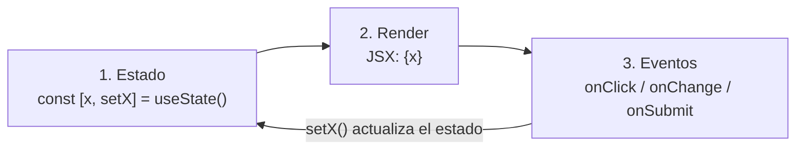

# 12. Los tres patrones de React: componente, useState y useEffect

- [12. Los tres patrones de React: componente, useState y useEffect](#12-los-tres-patrones-de-react-componente-usestate-y-useeffect)
  - [12.1. Los tres patrones que usarás sí o sí en React](#121-los-tres-patrones-que-usarás-sí-o-sí-en-react)
    - [12.1.1. Componente: función que recibe datos y devuelve UI](#1211-componente-función-que-recibe-datos-y-devuelve-ui)
    - [12.1.2. Estado con `useState`](#1212-estado-con-usestate)
    - [12.1.3. Carga de datos con `useEffect` + `fetch`](#1213-carga-de-datos-con-useeffect--fetch)
  - [12.2. Ejemplo completo: gestor de tareas en React](#122-ejemplo-completo-gestor-de-tareas-en-react)
  - [12.3. Ciclo en React: estado → render → eventos](#123-ciclo-en-react-estado--render--eventos)
- 🧪 **Ejercicios:** [useState y useEffect con fetch](../../../ejerciciosRT/ejerciciosRT.md#bloque-12-usestate-y-useeffect-con-fetch)

---

[Volver al índice general](../../../README.md#5-distribución-temporal-y-contenidos-s00s13)

Aquí están los **tres patrones** que usarás constantemente en React (`componente`, `useState`, `useEffect`), con código y un ejemplo completo. El repaso de TypeScript previo (el puente) está en el [apunte 11 · sección 11.0](11_Que_es_React.md#110-repaso-de-typescript-previo-el-puente).

> **Idea clave:** React no es un lenguaje nuevo. La lógica que ya sabes en TypeScript se reutiliza tal cual; React añade el cableado con la UI para que no tengas que repintar a mano. Si cambias datos y actualizas el estado, React se encarga del render.

---

## 12.1. Los tres patrones que usarás sí o sí en React

### 12.1.1. Componente: función que recibe datos y devuelve UI

```tsx
interface AlumnoProps {
  alumno: { nombre: string; curso: string; media: number };
}

function AlumnoCard({ alumno }: AlumnoProps) {
  return (
    <article>
      <h2>{alumno.nombre}</h2>
      <p>Curso: {alumno.curso}</p>
      <p>Nota media: {alumno.media.toFixed(1)}</p>
    </article>
  );
}

// <AlumnoCard alumno={profe} />
```

> [!NOTE]
> En `.tsx`. Usa `className`, y renderiza valores con `{}`. Las props se tipan con `interface`.

### 12.1.2. Estado con `useState`

Cuando un valor debe **recordarse y actualizar la UI** entre interacciones, usa `useState`. Actualiza objetos/arrays **sin mutar**.

```tsx
import { useState } from "react";

function Contador() {
  const [contador, setContador] = useState(0);

  return (
    <>
      <p>Contador: {contador}</p>
      <button onClick={() => setContador((c) => c + 1)}>+1</button>
    </>
  );
}
```

> [!NOTE]
> Usa la forma funcional `setX(x => ...)` si depende del valor anterior. Para objetos/arrays usa `{ ...obj }`, `[ ...arr ]`, `map`, `filter`.

### 12.1.3. Carga de datos con `useEffect` + `fetch`

```tsx
import { useEffect, useState } from "react";

interface Alumno {
  id: number;
  nombre: string;
}

function ListaAlumnos() {
  const [datos, setDatos] = useState<Alumno[] | null>(null);
  const [cargando, setCargando] = useState(true);
  const [error, setError] = useState<string | null>(null);

  useEffect(() => {
    const controller = new AbortController();

    async function cargar() {
      setCargando(true);
      setError(null);
      try {
        const res = await fetch("/api/alumnos", { signal: controller.signal });
        if (!res.ok) throw new Error(`Error ${res.status}`);
        setDatos((await res.json()) as Alumno[]);
      } catch (err) {
        if (err instanceof Error && err.name !== "AbortError") {
          setError(err.message);
        }
      } finally {
        setCargando(false);
      }
    }

    void cargar();
    return () => controller.abort();
  }, []);

  if (cargando) return <p>Cargando...</p>;
  if (error) return <p>{error}</p>;
  if (!datos) return <p>Sin datos</p>;

  return (
    <ul>
      {datos.map((a) => (
        <li key={a.id}>{a.nombre}</li>
      ))}
    </ul>
  );
}
```

---

## 12.2. Ejemplo completo: gestor de tareas en React

```tsx
import { useState } from "react";

interface Tarea {
  id: number;
  texto: string;
  completada: boolean;
}

export default function GestorTareas() {
  const [tareas, setTareas] = useState<Tarea[]>([]);
  const [texto, setTexto] = useState("");

  function añadir(e: React.FormEvent<HTMLFormElement>): void {
    e.preventDefault();
    const trimmed = texto.trim();
    if (!trimmed) return;
    setTareas([...tareas, { id: Date.now(), texto: trimmed, completada: false }]);
    setTexto("");
  }

  function toggle(id: number): void {
    setTareas(tareas.map((t) => (t.id === id ? { ...t, completada: !t.completada } : t)));
  }

  function borrar(id: number): void {
    setTareas(tareas.filter((t) => t.id !== id));
  }

  const pendientes = tareas.filter((t) => !t.completada).length;

  return (
    <div>
      <h1>Gestor de tareas</h1>
      <form onSubmit={añadir}>
        <input value={texto} onChange={(e) => setTexto(e.target.value)} placeholder="Nueva tarea..." />
        <button type="submit">Añadir</button>
      </form>
      <ul>
        {tareas.map((t) => (
          <li key={t.id}>
            <span style={{ textDecoration: t.completada ? "line-through" : "none" }}>{t.texto}</span>{" "}
            <button onClick={() => toggle(t.id)}>{t.completada ? "Desmarcar" : "Completar"}</button>{" "}
            <button onClick={() => borrar(t.id)}>Borrar</button>
          </li>
        ))}
      </ul>
      <p>{pendientes} pendientes</p>
    </div>
  );
}
```

> [!NOTE]
> Todo lo anterior (`map`, `filter`, *spread*, validación) es TypeScript puro. React solo conecta con la UI.

---

## 12.3. Ciclo en React: estado → render → eventos



> [!NOTE]
> **Declarativo:** describes el UI en función del estado. Al llamar al *setter*, React vuelve a renderizar lo necesario. No actualices el DOM a mano.


---

[Volver al índice general](../../../README.md#5-distribución-temporal-y-contenidos-s00s13)