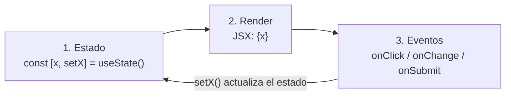

# 12. Los tres patrones de React: componente, useState y useEffect

- [12. Los tres patrones de React: componente, useState y useEffect](#12-los-tres-patrones-de-react-componente-usestate-y-useeffect)
  - [12.1. Los tres patrones que usarás sí o sí en React](#121-los-tres-patrones-que-usarás-sí-o-sí-en-react)
    - [12.1.1. Componente: función que recibe datos y devuelve UI](#1211-componente-función-que-recibe-datos-y-devuelve-ui)
    - [12.1.2. Estado con `useState`](#1212-estado-con-usestate)
    - [12.1.3. Carga de datos con `useEffect` + `fetch`](#1213-carga-de-datos-con-useeffect--fetch)
  - [12.2. Errores comunes y debugging](#122-errores-comunes-y-debugging)
  - [12.3. Resumen: los tres patrones en una tabla](#123-resumen-los-tres-patrones-en-una-tabla)
- 🧪 **Ejercicios:** [useState y useEffect con fetch](../../../ejerciciosRT/ejerciciosRT.md#bloque-12-usestate-y-useeffect-con-fetch)

---

[Volver al índice general](../../../README.md#5-distribución-temporal-y-contenidos-s00s13)

Aquí vemos a fondo los **tres patrones** que usaremos constantemente en React (`componente`, `useState`, `useEffect`), con código. El **ejemplo completo** que junta los tres (un gestor de peliculas) se ve en el apunte 13 (§13.8), ya con el tipado de eventos. Cada sección explica *por qué* se hace, *cómo* se hace y *qué puede salir mal*.

**El ciclo que lo gobierna todo: estado → render → eventos**



**Declarativo: no actualices el DOM a mano**

```tsx
// MAL: manipulas el DOM directamente
document.getElementById("saludo").textContent = "Hola";

// BIEN: describes qué quieres y React lo hace
<h1>{nombre}</h1>
```

Si manipulas el DOM a mano, React no lo sabe. En el siguiente diff, React cree que el DOM sigue siendo el anterior y **no** aplica el cambio. El resultado: UI inconsistente, bugs difíciles de depurar.

> [!NOTE]
> **Declarativo:** describes el UI en función del estado. Al llamar al *setter*, React vuelve a renderizar lo necesario. No actualices el DOM a mano.

---

## 12.1. Los tres patrones que usarás sí o sí en React

### 12.1.1. Componente: función que recibe datos y devuelve UI

Repasamos qué es un **componente** y avanzamos. Un componente es una función TypeScript que recibe datos (props) y devuelve JSX. Es la unidad básica de composición en React: igual que en TS compones funciones pequeñas para formar funciones grandes, en React compones componentes pequeños para formar la interfaz.

**¿Por qué componentes?**

| Problema sin componentes | Solución con componentes |
|---|---|
| Repites el mismo bloque de JSX 5 veces | Lo extraes a una función y la llamas 5 veces |
| Un fichero de 400 líneas de JSX | Varios ficheros de 50-80 líneas, uno por componente |
| Cambias un dato y tienes que tocar 3 sitios | Cambias el dato en un sitio y los 3 componentes lo reciben por props |
| No sabes qué hace un bloque de UI | El nombre del componente te lo dice: `<PeliculaCard />` |

**Anatomía de un componente:**

```
Entrada (props) → Función (lógica + estado) → Salida (JSX)
     ⬇                    ⬇                      ⬇
  {alumno}          useState, useEffect      <article>...</article>
```

- **Props:** datos de entrada, de solo lectura. El padre decide qué pasar (y determina el nombre del props).
- **Estado interno:** datos que el componente gestiona solo (con `useState`).
- **JSX:** la salida. Lo que se pinta.

**Composición:** un componente puede contener otros. El padre pasa datos por props; el hijo los pinta. Si dos hermanos necesitan el mismo dato, el padre lo gestiona y se lo pasa a ambos (*lifting state up*, visto en §11.5).

**Convenciones:**

- Nombre en **Mayúscula inicial** (`AlumnoCard`, no `alumnoCard`). React distingue un componente de una etiqueta HTML por la mayúscula.
- **Un componente por fichero**: `AlumnoCard.tsx` contiene `AlumnoCard`.
- `export default` para el componente principal del fichero; `export function` para helpers (funciones auxiliares).
- El tipo de props se llama `XProps` (convención universal).

```tsx
//Ejemplo de componente alumno que se muestra en un Card
interface AlumnoProps {
  //Si el atributo es a su vez un objeto facilita la firma del Componente   
  alumno: { nombre: string; curso: string; media: number };
}

//Usamos article: similar a div o a section
//solo que tiene identidad propia (podría llevármelo a otra web y seguiría funcionando)
function AlumnoCard({ alumno }: AlumnoProps) {
  return (
    <article>
      <h2>{alumno.nombre}</h2>
      <p>Curso: {alumno.curso}</p>
      <p>Nota media: {alumno.media.toFixed(1)}</p>
    </article>
  );
}

// Llamada en padre:
// <AlumnoCard alumno={alumnObj} />
// No es necesario tipar AlumnoProps en padre, se crea un objeto "normal" y se le pasa con la misma estructura  
// del props o incluso se toma de distintos sitios para constuir alumnObj (simulación de formulario)
```

> [!NOTE]
> Una práctica común es utilizar `className` para dar estilos. De esta forma podríamos poner: `<h2 className="alumno-nombre">{alumno.nombre}</h2>` con: 

```css 
/*Fichero estilos.css*/
.alumno-nombre {
  color: #169e0a;
  border-width: 1px;
  border-style: solid;  /* ¡Obligatorio! Define si el borde es sólido, punteado, etc. */
  border-color: #0004ff; /* Color del borde (puedes poner el que quieras) */

...
/*Fichero AlumnoCard.tsx*/
// @ts-expect-error-Ignora error de tipos de CSS para esta línea
import "./estilos.css";
...
}
```
> [!NOTE]
> No obstante, y para separar funcionalidad de diseño, aún NO SE VA A INCLUIR NADA DE ESTILOS hasta llegar a la parte de TailWind CSS, incluyendo el estilo en la propia etiqueta. Ejemplo: 
`<h2 className="text-xl font-bold text-gray-800 mb-2">{alumno.nombre}</h2>`

**Errores comunes al empezar:**

- **Mutar props:** `alumno.nombre = "X"` → NO. Las props son de solo lectura. Si necesitas cambiar algo, el padre lo cambia y te lo pasa de nuevo.
- **No olvidar poner `key` en listas:** si renderizas `{items.map(...)}`, cada elemento necesita `key={item.id}`. Sin `key`, React no sabe qué elemento cambió y puede re-renderizar todo.
- NO se puede meter **Hooks:** en condiciones.  ~~if (x) { const [a, setA] = useState(0); }~~ , esto provoca error de React.. Los hooks se llaman siempre, en el mismo orden, en cada render. 

---

### 12.1.2. Estado con `useState`

**¿Por qué necesitamos estado?**

Ya sabemos que una UI no es estática: el usuario escribe, pulsa, selecciona. React necesita un mecanismo para **recordar** valores entre renders y **volver a pintar** cuando cambian. Ese mecanismo es `useState`.

**NO CONFUNDIR! Diferencia props vs estado:**

| | Props | Estado (`useState`) |
|---|---|---|
| ¿Quién lo gestiona? | El padre (pasando datos y controlando estados) | El propio componente |
| ¿Puedo cambiarlo? | No (de solo lectura) | Sí, con el *setter* |
| ¿Cuándo cambia? | Cuando el padre re-renderiza con otro valor | Cuando llamo al *setter* |
| Ejemplo | `alumno.nombre` | `contador`, `tareas`, `texto` |

**Anatomía de `useState`:**

```tsx
const [valor, setValor] = useState<T>(valorInicial);
```

- `valor`: el dato actual (lo lees en el JSX).
- `setValor`: la función para cambiarlo (la llamas en eventos). Es un CLOSURE.
- `T`: el tipo genérico (opcional si TS lo infiere).
- `valorInicial`: solo se usa en el **primer** render. En renders posteriores, React usa el estado interno.

**Qué pasa exactamente cuando llamas al *setter*:**

1. React **no** actualiza el DOM inmediatamente.
2. React **marca** el componente como "sujeto a re-render".
3. React **agenda** un nuevo render (puede agrupar varios `setState` en el mismo evento → *batching*).
4. React **ejecuta** la función del componente de nuevo con el estado actualizado.
5. React **compara** el JSX nuevo con el anterior (*diff* sobre el Virtual DOM).
6. React **aplica** solo los cambios mínimos al DOM real.

Ejemplo: un botón en un formulario que realiza comprobaciones y "cambia" según estado de fallos.

**Batching:** si en un mismo *handler* (función que se llama al usar un evento `onClick`, `onChange`, etc)  llamas a dos `setState`, React hace **un solo** re-render, no dos. Dentro del batch, el valor "directo" (`x`) es el del render actual, no el que resultará de la llamada anterior — por eso la forma funcional `setX(x => ...)` importa.

**<mark>Inmutabilidad: recordando la regla de oro</mark>**

React detecta cambios por **referencia**. Si mutas el objeto/array en lugar de crear uno nuevo, React no sabe que ha cambiado y **no re-renderiza**. Se utilizan funciones callbacks, donde un valor denominado genéricamente p (previous), se usa para crear un nuevo objeto para pasárselo a un setter.

| <span style="color: red;">MAL (mutación)</span> | <span style="color: green;">BIEN (inmutable)</span> |
|---|---|
| `usuario.edad = 100; setUsuario(usuario);` | `setUsuario(p => ({ ...p, edad: p.edad + 1 }));` |
| `tareas.push(nueva); setTareas(tareas);` | `setTareas(t => [...t, nueva]);` |
| `tareas[0].completada = true; setTareas(tareas);` | `setTareas(t => t.map(x => x.id === 0 ? { ...x, completada: true } : x));` |

**Actualizaciones funcionales: `setX(x => ...)`** :  es lo contrario a pasar un valor directo (ejemplo: setX(5)), es decir, consiste en pasar una función como argumento al setter de un estado.

**REGLA IMPORTANTE!!** Si el nuevo valor depende del valor anterior, hay que usar la forma funcional:

```tsx
// MAL: si React agrupa (batching), 'contador' es el mismo en ambas llamadas
setContador(contador + 1);
setContador(contador + 1); // solo sube 1, no 2

// BIEN: cada llamada toma el valor actualizado de la anterior
setContador(c => c + 1);
setContador(c => c + 1); // sube 2 correctamente
```

Esto es crítico dentro de `setTimeout`, `fetch` o cualquier contexto donde React pueda agrupar actualizaciones.

**<mark>Estado derivado: no lo guardes, calcúlalo "al vuelo"</mark>**

Si un valor se puede **calcular** a partir del estado existente, no lo guardes en otro `useState` (habría duplicidad). Calcúlalo en el render:

```tsx
// Ejemplo: calcular el número total de tareas  que aún están pendientes por completar (en array tareas).
// ¿Hace necesario usar un estado?
// MAL: Obliga a tener actualizado correctamente el número de pendientes.
const [pendientes, setPendientes] = useState(0);

// BIEN: se calcula cada render "al vuelo", siempre estará sincronizado
const pendientes = tareas.filter(t => !t.completada).length;
```

**<mark>Colocación del estado: ¿dónde vive?</mark>**

El estado "vive" (se crea y usa) en el componente **más bajo** que lo necesita. Si dos hermanos lo necesitan, se sube al padre común (*lifting state up*). No lo subas más de lo necesario: si solo lo usa un hijo, que lo tenga él. Podemos recordar el ejemplo mínimo del repositorio: `const [texto,setTexto]=setState("")` tiene sentido que el valor se suba al  padre pero no más de ahí.

***Ejemplo Compuesto: Utilizando varios estados en un mismo componente***

```tsx
// Ejemplo compuesto: primitivo, objeto y array
import { useState } from "react";

interface Tarea {
    id: number; 
    texto: string; 
    completada: boolean; 
}

interface Usuario { 
    nombre: string; 
    edad: number; 
}

export function EjemploUseStateCompuesto() {
    // 1. PRIMITIVO (Número)
    const [contador, setContador] = useState(0);
    //Incrementa de 2 en 2, pero tal y como está hecho, lo haría de 3 en 3
    const incrementar = () => {
        //Con lectura directa: si React agrupa las llamadas, 'contador' sigue valiendo lo mismo
        //Esto podría fallar dentro de un setTimeout o un fetch
        setContador(contador+1);
        setContador(contador+1); // ¡El contador solo sube 1 en vez de 2!
        //Tampoco se utilizarían otros comandos mutables como c++

        //Con forma Funcional (inmutabilidad): cada llamada toma el valor actualizado de la anterior
        setContador(c => c+1);
        setContador(c => c+1); // El contador sube 2 correctamente
    };


    // 2. OBJETO
    const [usuario, setUsuario] = useState<Usuario>({ nombre: "Matusalén", edad: 969 });
    //MAL: usuario.edad = 100; setUsuario(usuario);
    //const cumplirAnios = () => setUsuario(usuario); // MAL, no da error de compilacion, PERO usuario no ha cambiado
    const cumplirAnios = () => setUsuario(p => ({ ...p, edad: p.edad + 1 })); // BIEN (spread)

    // 3. ARRAY
    const [tareas, setTareas] = useState<Tarea[]>([
        { id: 1, texto: "Aprender React", completada: true },
    ]);
    // MAL: tareas.push(nueva); setTareas(tareas);
    const agregar = () => setTareas(t => [...t, { id: Date.now(), texto: "Nueva", completada: false }]); // BIEN, usamos SPREAD ([...arr])
    const toggle = (id: number) => setTareas(t => t.map(x => x.id === id ? { ...x, completada: !x.completada } : x)); // BIEN, usamos MAP (map)
    const eliminar = (id: number) => setTareas(t => t.filter(x => x.id !== id)); // BIEN (filter)

    return (
        <div>
            <div>
                <p>Contador de 2 en 2: {contador}</p>
                <button onClick={incrementar}>+2</button>
            </div>
            <div>
                <p>{usuario.nombre} ({usuario.edad} años)</p>
                <button onClick={cumplirAnios}>Cumplir años</button>
            </div>
            <div>
                <ul>
                    {tareas.map(t => (
                        <li key={t.id}> {/* Usamos un estilo condicional para tachar (funcionamiento). No para diseñar */}
                            <span onClick={() => toggle(t.id)} style={{ textDecoration: t.completada ? "line-through" : "none" }}>
                                {t.texto}
                            </span>
                            <button onClick={() => eliminar(t.id)}>X</button>
                        </li>
                    ))}
                </ul>
                <button onClick={agregar}>Añadir</button>
            </div>
        </div>
    );
}

export default EjemploUseStateCompuesto;
//Probamos el componente
```

> [!NOTE]
> Usa la forma funcional `setX(x => ...)` si depende del valor anterior. Para objetos/arrays usa `{ ...obj }`, `[ ...arr ]`, `map`, `filter`.

---

### 12.1.3. Carga de datos con `useEffect` + `fetch`

**¿Qué es un efecto secundario?**

Es cualquier operación que **no** sea "calcular el JSX a partir del estado", sirve para **conectarse a servicios externos**: hacer una petición HTTP, modificar el DOM directamente, suscribirse a un evento (resize, scroll, WebSocket...) o programar un `setTimeout`. React no puede hacer estas cosas durante el render (que debe ser puro [siempre con igual resultado ante los mismos datos de entrada] y síncrono), así que las relega a `useEffect`.
[!NOTE]
> HTTP funciona mediante solicitudes puntuales del cliente (que pueden hacerse miles de veces en segundo plano sin recargar la página), mientras que un WebSocket abre un canal continuo y abierto donde el servidor puede enviar datos a la app en cualquier momento.


**¿Cuándo se ejecuta `useEffect`?**

```tsx
useEffect(() => {
  // código del efecto
}, [dependencias]);
```

| Array de dependencias | Cuándo se ejecuta |
|---|---|
| `[]` (vacío) | **Una vez**, cuando el componente **monta** (entra en pantalla) |
| `[valor]` | Cada vez que `valor`**cambia** (comparación con `Object.is`) |
| Sin array | **Cada render** (peligroso: bucles infinitos si actualizas estado) |

**Cleanup: la función de retorno**  

El cleanup es el mecanismo que nos ofrece useEffect para **deshacer o limpiar** los efectos secundarios que inició el componente antes de que este muera o de que el efecto vuelva a lanzarse.  Por ejemplo, lanzamos una petición muy larga, y antes de que termine, cerramos ventana o cambiamos los parámetros del fetch (peligro de inconsistencias en la APP).

```tsx
//Ejemplo SIN DESARROLLAR de AbortController (se hace más abajo)
useEffect(() => {
  const controller = new AbortController(); //API nativa de JavaScript
  // ... fetch con controller.signal
  return () => controller.abort(); // se ejecuta al desmontar y antes de re-ejecutar (para sin consecuencias)
}, []);
```

El **cleanup** se ejecuta:
1. Cuando el componente **se desmonta** (sale de pantalla).
2. **Antes** de que el efecto se re-ejecute (si cambian las dependencias).

Sin cleanup: fugas de memoria, peticiones "zombi" que actualizan un componente ya desmontado, `setTimeout` que se ejecuta sobre un componente que ya no existe => La APP peta. Solución? : `<React.StrictMode>` se encarga precisamente de comprobar que los cleanup se hacen bien.

**Efecto vs. handler de evento: ¿cuándo usar cada uno?**

| Situación | Usar |
|---|---|
| Cargar datos al montar | `useEffect` |
| Actualizar `document.title` cuando cambia un estado | `useEffect` |
| Suscribirse a un WebSocket / evento del DOM  (estar atento a una acción concreta. ej: resize)| `useEffect` |
| Responder a un clic del usuario | Handler (`onClick`) |
| Responder a escribir en un input | Handler (`onChange`) |
| Enviar un formulario | Handler (`onSubmit`) |

Regla: si el código **depende de una interacción del usuario**, va en un handler. Si **depende del ciclo de vida del componente** (montar, desmontar, cambiar una dep), va en `useEffect`.

**Errores comunes con `useEffect`:**

- **Olvidar dependencias → *stale closure*:** el efecto captura el valor del primer render. Si usas una variable que cambia y no la pones en deps, el efecto siempre ve el valor antiguo.
- **Bucle infinito:** `useEffect(() => setDatos(datos + 1), [datos])` → cada vez que `datos` cambia, el efecto se re-ejecuta, cambia `datos` de nuevo… infinito.
- **Olvidar cleanup:** peticiones en vuelo que actualizan un componente desmontado. React te avisa en consola: *"Can't perform a React state update on an unmounted component"*.
- **Usar `useEffect` para datos derivados:** si puedes calcularlo en el render (`const pendientes = tareas.filter(...)`), no lo hagas en un efecto. El efecto es para cosas que React no puede calcular.

Ejercicio 1 - Bloque 12 - Ejemplo completo de un **useEffect+fetch+estado de carga+cleanup** (requiere lanzar json-server con alumnos.json):

```tsx
import { useEffect, useState } from "react";

interface Alumno {
  id: number;
  nombre: string;
}

function ListaAlumnos() {
  //Definimos estados para "estados de carga"
  const [cargando, setCargando] = useState(true);  
  const [datos, setDatos] = useState<Alumno[] | null>(null);
  const [error, setError] = useState<string | null>(null);

  useEffect(() => {
    const controller = new AbortController();

    async function cargar() {
    //La función principal de un useEffect NUNCA puede ser un async,
    // por tanto, se crea una función auxiliar y se llama más abajo
      setCargando(true); //Si comentamos bloque try-catch, podremos ver efecto "Cargando"
      setError(null);
      try {
        const res = await fetch("http://localhost:3000/alumnos", { signal: controller.signal });
        // Se asocia el fetch con una señal del controlador, de forma que si para lo sabermos.   
        if (!res.ok) throw new Error(`Error ${res.status}`);
        setDatos((await res.json()) as Alumno[]);//Si comentamos, obtenemos "sin datos"
      } catch (err) {
        if (err instanceof Error && err.name !== "AbortError") {
          setError(err.message);
        }
      } finally {
        setCargando(false);
      }
    }

    void cargar();
    //Hacemos un return: estamos creando un Closure
    //Cuando se desmonte el componente o se re-ejecute el efecto,
    //aborta la petición en vuelo para evitar actualizar un componente desmontado
    return () => controller.abort();
  }, []);

  //Al ser una única etiqueta el return puede ir sin ()
  if (cargando) return <p>Cargando...</p>;
  //Alternativa: {cargando && <p>Cargando...</p>}
  if (error) return <p>{error}</p>;
  //Si cortamos el servidor json-server veremos error de fallo de fetch
  //Alternativa: {!cargando && error && <p>{error}</p>}
  if (!datos) return <p>Sin datos</p>;
  //Alternativa: {!cargando && !error && !datos && <p>Sin datos</p>}

  return (
    <ul>
      {datos.map((a) => (
        <li key={a.id}>{a.nombre}</li>
      ))}
    </ul>
  );
}

//Montar componente y ver el efecto
```

**Desglose del ejemplo:**

| Línea | ¿Por qué? |
|---|---|
| `useState<Alumno[] \| null>(null)` | `null` = "todavía no hay datos". Distingue de `[]` (cargado y vacío). |
| `useState(true)` para `cargando` | Empieza en `true` porque el fetch aún no ha respondido. |
| `AbortController` | Si el componente se desmonta antes de que llegue la respuesta, cancela la petición. Evita actualizar un componente que ya no existe. |
| `res.ok` | `fetch` **no** lanza error con 404/500. Comprueba el estado manualmente. |
| `err.name !== "AbortError"` | Si nosotros mismos cancelamos (cleanup), no es un error real: no lo mostramos. |
| `finally` | `cargando` pasa a `false` tanto si hay error como si no. |
| `if (cargando) return ...` | **Render condicional**: no pintas la lista hasta que hay datos. Evita `undefined.map(...)`. |

---

## 12.2. Errores comunes y debugging

| Error | Síntoma | Solución |
|---|---|---|
| Mutar estado directamente (`arr.push`, `obj.x = ...`) | No re-renderiza; la UI no cambia | Spread `{ ...obj }`, `[...arr]`, `map`, `filter` |
| Olvidar `key` en `map` | Comportamiento raro: elementos se "mueven", inputs pierden el foco | `key={item.id}` (nunca el índice si la lista cambia) |
| `useEffect` sin array de deps | Bucle infinito; la consola se llena de peticiones | Añadir `[deps]` con las variables que usa el efecto |
| *Stale closure* en `setTimeout` / `fetch` | El valor es el del primer render, no el actual | Actualización funcional: `setX(x => x + 1)` |
| Mutar props | Comportamiento impredecible; el padre no se entera | No mutar; pedir al padre que cambie el dato |
| Hooks dentro de `if` / bucle | Error: "Rendered fewer hooks than expected" | Llamar hooks siempre, en el mismo orden, al inicio del componente |
| `useState` con función que depende de props | El valor inicial no se actualiza si la prop cambia | Derivar en el render o usar `useEffect` para sincronizar |
| `fetch` sin `AbortController` | "Can't perform state update on unmounted component" | `return () => controller.abort()` en el cleanup |

**Debugging:**

- **`console.log` en el componente:** se ejecuta **cada render**. Si ves el log repetido, el componente se está re-renderizando (normal si cambió su estado o sus props; anormal si no cambió nada).
- **React DevTools** (extensión del navegador): inspecciona el árbol de componentes, el estado de cada uno y las props. Permite "forzar" un re-render para ver si el componente responde.
- **`<React.StrictMode>`:** en desarrollo, ejecuta cada componente **dos veces** para detectar efectos impuros (mutaciones, suscripciones sin cleanup). No afecta en producción.
- **`npx tsc --noEmit`:** valida tipos sin compilar. Detecta errores de props, estado y eventos antes de ejecutar.

---

## 12.3. Resumen: los tres patrones en una tabla

| Patrón | Cuándo lo usas | Ejemplo mínimo | Regla de oro |
|---|---|---|---|
| **Componente** | Reutilizar UI, componer la interfaz | `<AlumnoCard alumno={a} />` | Props de solo lectura; un componente por fichero; nombre en Mayúscula |
| **`useState`** | Recordar y actualizar la UI entre interacciones | `const [tareas, setTareas] = useState<Tarea[]>([])` | Nunca mutar: spread, `map`, `filter`. Forma funcional si depende del valor anterior |
| **`useEffect`** | Efectos secundarios: fetch, DOM, suscripciones, timers | `useEffect(() => { fetch(...) }, [])` | Siempre cleanup. Deps correctas. No para datos derivados |

**Reglas de oro (las 5 que no debes olvidar):**

1. **UI = f(estado).** Describe qué quieres, no cómo actualizar el DOM.
2. **No mutar.** Estado y props: siempre crear copias nuevas.
3. **`key` en listas.** Identidad estable, nunca el índice si la lista cambia.
4. **Hooks al inicio.** Mismo orden, cada render. Nunca condicionales.
5. **Cleanup en `useEffect`.** Cancelar peticiones, timers y suscripciones.

---

## 📦 Ejemplos ejecutables

En [`repos/02-react-componentes`](../../../repos/02-react-componentes/) las pestañas **Básicos** y **SWAPI** agrupan los ejemplos de este apunte:

| Pestaña | Ejemplos | Qué demuestra |
|---|---|---|
| **Básicos** | `Saludo.tsx` · `Card.tsx` · `ListaTareas.tsx` · `ListaUsuarios.tsx` | Props tipadas · `children` · `useState` · `useEffect` + `fetch` (3 estados) |
| **SWAPI** | `Swapi.tsx` | `useEffect` + `fetch` a una API real (cargando/error/datos) |

Para ejecutarlos: `cd repos/02-react-componentes && npm run dev` → pestañas **Básicos** y **SWAPI**.

---

[Volver al índice general](../../../README.md#5-distribución-temporal-y-contenidos-s00s13)
